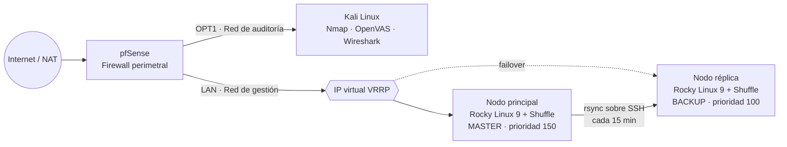
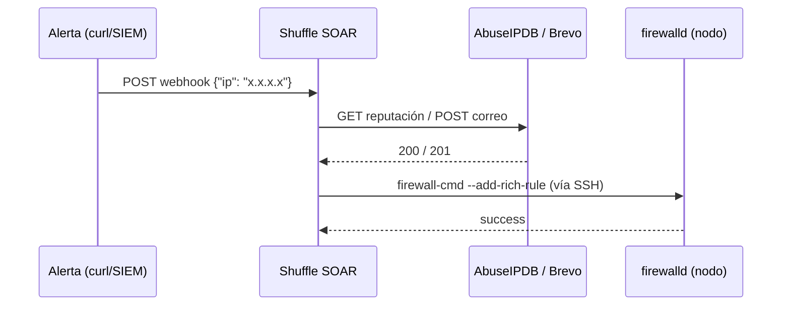

# 🛡️ Shuffle SOAR con Alta Disponibilidad y Hardening

[](https://rockylinux.org/)
[](https://shuffler.io/)
[](https://www.pfsense.org/)
[](https://keepalived.org/)
[](https://docs.docker.com/compose/)
[](./LICENSE)
[]()

> **Proyecto de título** de la carrera Técnico en Ciberseguridad. Implementé una plataforma **SOAR** (Shuffle) para el SOC de una PYME de ciberseguridad, con **hardening** del servidor, **firewall perimetral** con segmentación, **failover automático** entre dos nodos y **tres playbooks** de respuesta a incidentes.

> 🔒 **Confidencialidad:** el proyecto se hizo para una empresa real. Su nombre, sus datos y las direcciones de red fueron anonimizados en este repositorio. En adelante se la llama *"la consultora"*.

---

## 📋 Tabla de contenidos

- [Contexto y problema](#-contexto-y-problema)
- [Arquitectura](#️-arquitectura)
- [Tecnologías utilizadas](#️-tecnologías-utilizadas)
- [Fases de implementación](#-fases-de-implementación)
- [Playbooks SOAR](#-playbooks-soar)
- [Resultados](#-resultados)
- [Estructura del repositorio](#-estructura-del-repositorio)
- [Aprendizajes](#-aprendizajes)
- [Autora](#-autora)

---

## 🎯 Contexto y problema

La consultora (PYME con ~18 personas, servicios de Ethical Hacking, CTI, SOC e ISO 27001, y más de 25 clientes activos) tenía estos problemas en su SOC:

- La respuesta a incidentes era **mayormente manual**, sin un motor de playbooks.
- Las integraciones entre SIEM, EDR, ticketing y feeds de CTI eran *ad hoc* y sin trazabilidad.
- **No existía alta disponibilidad**: si el servidor principal caía durante un incidente, el SOC quedaba sin respuesta automatizada.

**Objetivo general:** implementar una plataforma SOAR con alta disponibilidad y hardening que automatizara la respuesta a incidentes, mediante Shuffle SOAR, un nodo de réplica sincronizado con Keepalived y tres playbooks funcionales.

| Objetivo específico | Estado |
|---|---|
| OE1 – Hardening del nodo principal (CIS Benchmarks + NIST SP 800-123) | ✅ |
| OE2 – Nodo de réplica con failover automático (Keepalived/VRRP) | ✅ |
| OE3 – Tres playbooks de respuesta probados y ejecutados | ✅ |
| OE4 – pfSense como firewall perimetral con segmentación de redes | ✅ |

---

## 🗺️ Arquitectura



- **pfSense** separa la red de gestión (nodos SOAR) de la red de auditoría (Kali). Una sola regla de paso deja que la red de auditoría llegue **solo** a la red de gestión.
- **Keepalived (VRRP)** publica una IP virtual. Si el contenedor de Shuffle falla en el nodo principal, la réplica toma la IP en forma automática.
- **rsync + cron** copia los volúmenes de Shuffle (workflows, credenciales cifradas, historial) del nodo principal a la réplica.

> Las direcciones IP de este repositorio son genéricas.

---

## 🛠️ Tecnologías utilizadas

| Categoría | Herramienta |
|---|---|
| Orquestación (SOAR) | Shuffle SOAR (Docker Compose, OpenSearch) |
| Sistema operativo de los nodos | Rocky Linux 9 |
| Alta disponibilidad | Keepalived (VRRP), rsync, cron |
| Firewall perimetral | pfSense |
| Hardening | firewalld, fail2ban, SSH con llaves ed25519, SELinux |
| Auditoría técnica | Kali Linux: Nmap, OpenVAS/Greenbone, Wireshark |
| Integraciones de los playbooks | AbuseIPDB (API REST), Brevo (API de correo), SSH |
| Virtualización | VMware Workstation |
| Marcos de referencia | CIS Controls, NIST SP 800-123, NIST SP 800-61r3, NIST SP 800-30, ISO/IEC 27001:2022 |

---

## 🔧 Fases de implementación

### 1️⃣ Hardening del servidor SOAR
- 🔑 SSH solo con llave **ed25519**: `PasswordAuthentication no`, `PermitRootLogin no`. Lo verifiqué forzando un login con contraseña, que el servidor rechazó (`Permission denied (publickey…)`).
- 🧱 **firewalld:** quité el servicio `cockpit`, que no se usaba, y abrí solo los puertos de Shuffle (3001/3443).
- 🚫 **fail2ban** con el jail `[sshd]`: `maxretry=3`, `findtime=600`, `bantime=3600`.
- 🕒 Bloqueé las respuestas **ICMP Timestamp** con una *rich rule*. Así mitigué el único hallazgo de OpenVAS (CVE-1999-0524).
- 🐳 **Hallazgo propio:** después del hardening, Nmap mostró los puertos **5001** (backend) y **9200** (OpenSearch) abiertos. Docker los publicaba con `docker-proxy` y se saltaba las reglas de firewalld. Lo corregí limitando esos puertos a `127.0.0.1` en `docker-compose.yml`.
- ✅ **Resultado:** la superficie quedó en **solo 22/tcp (SSH) y 3001/tcp (Shuffle)**.

### 2️⃣ Firewall perimetral con pfSense
- Tres interfaces: **WAN** (NAT), **LAN** (red de gestión) y **OPT1** (red de auditoría).
- OPT1 bloquea todo por defecto. Agregué **una sola regla de paso**: origen la red de auditoría, destino la red de gestión. No usé una regla "any → any".
- Validé de punta a punta: ping a ambos gateways y acceso web a Shuffle desde Kali, a través del firewall.

### 3️⃣ Alta disponibilidad (Keepalived + VRRP)
- La réplica es un clon del nodo principal. Le cambié el hostname, el `machine-id`, las llaves de host SSH y la IP estática.
- El `vrrp_script` revisa cada 2 s, con `docker ps`, que el contenedor `shuffle-frontend` esté corriendo.
- **Corrección importante:** con `priority 150` y `weight -20`, una falla solo bajaba la prioridad a 130. Eso sigue siendo mayor que los 100 de la réplica, así que **el failover nunca habría ocurrido**. Lo ajusté a `weight -60` (150 − 60 = 90 < 100).
- Para que Keepalived pudiera ejecutar Docker resolví una denegación de SELinux. Usé `semanage permissive -a keepalived_t` en vez de desactivar SELinux completo.
- **Prueba de failover:** detuve el contenedor y la réplica tomó la IP virtual con **0 % de pérdida de paquetes**. Al restaurarlo, el nodo principal recuperó el rol (*failback*). También lo verifiqué en **Wireshark** (anuncios VRRP a `224.0.0.18`) y no hubo *split-brain*.
- **Sincronización de datos:** cron ejecuta `rsync` sobre SSH cada 15 minutos. Usa una llave dedicada, un usuario no privilegiado en la réplica y `sudo` limitado a **un único script**. Lo probé con el workflow `TEST_SYNC_HA`, que apareció en la réplica.

### 4️⃣ Playbooks de respuesta (ver abajo)

---

## 🤖 Playbooks SOAR

La instancia de Shuffle **no tenía acceso al catálogo comunitario de apps**. Por eso construí los tres playbooks con el trigger **Webhook**, la app genérica **Http** (para APIs REST) y la acción **Run ssh command** de Shuffle Tools.

| Playbook | Qué automatiza | Cómo lo validé |
|---|---|---|
| `Enriquecimiento_IoC_IP` | Consulta la reputación de una IP en **AbuseIPDB** | Respuesta HTTP 200 con los datos de reputación, probado con 2 IPs |
| `Notificacion_Alertas_Criticas` | Envía un correo al SOC mediante la API de **Brevo** | HTTP 201 + `messageId`, y el correo llegó a la bandeja |
| `Bloqueo_IPs_Maliciosas` | Agrega una *rich rule* de bloqueo en firewalld vía SSH | `success: true` y la regla verificada con `firewall-cmd --list-rich-rules` |



📄 El detalle de cada flujo está en [`playbooks/`](./playbooks).

---

## 📊 Resultados

| Indicador | Antes | Después |
|---|---|---|
| Puertos expuestos en el nodo SOAR | 22 + puertos de Docker (5001, 9200) expuestos por error | **22 y 3001** |
| Disponibilidad ante una falla del nodo principal | 0 % (sin respaldo) | **Failover automático**, 0 % de pérdida en la prueba |
| Alertas recurrentes con respuesta automatizada | 0 categorías | **3 categorías** (IoC, alertas críticas, bloqueo de IP) |
| Separación entre la red de auditoría y la de gestión | No existía | **Regla de mínimo privilegio** en pfSense |

**Limitaciones reconocidas**
- La sincronización es periódica (cada 15 min), no en tiempo real.
- Todo se validó en un laboratorio virtualizado. Las métricas de MTTR todavía hay que confirmarlas en producción.

**Trabajo futuro:** replicación continua de OpenSearch, conectores dedicados en vez de Http genérico e integración con Wazuh o Suricata como fuentes de alertas.

---

## 📁 Estructura del repositorio

```
.
├── README.md
├── LICENSE
├── configs/
│   ├── keepalived-master.conf.example   # Nodo principal (MASTER, prioridad 150)
│   ├── keepalived-backup.conf.example   # Nodo réplica (BACKUP, prioridad 100)
│   ├── jail.local.example               # fail2ban: jail [sshd]
│   ├── sshd_config.hardening.example    # Directivas SSH endurecidas
│   └── docker-compose.override.example  # Puertos internos solo en localhost
├── scripts/
│   ├── hardening_firewalld.sh           # Reglas de firewalld aplicadas
│   ├── check_shuffle.sh                 # Health check que usa Keepalived
│   ├── shuffle_sync.sh                  # Sincronización (nodo principal, cron)
│   └── shuffle_sync_apply.sh            # Aplicación de la sincronización (réplica)
└── playbooks/
    ├── 01_enriquecimiento_ioc_ip.md
    ├── 02_notificacion_alertas_criticas.md
    └── 03_bloqueo_ips_maliciosas.md
```

> ⚠️ Los archivos de `configs/` y `scripts/` los reconstruí desde la documentación del proyecto, con valores genéricos. Revísalos y adáptalos antes de usarlos en otro entorno.

---

## 💡 Aprendizajes

- ✅ **La alta disponibilidad se valida con aritmética, no copiando sintaxis.** El `weight` de VRRP tiene que hacer que la prioridad baje por debajo de la del nodo de respaldo.
- ✅ **Docker puede saltarse el firewall del host.** Hay que revisar los *bindings* de puertos, no solo las reglas de firewalld.
- ✅ **La solución rápida no siempre es la correcta.** Acotar SELinux a un dominio tomó más tiempo que desactivarlo, pero conservó el hardening.
- ✅ **Adaptarse a las restricciones reales.** Sin conectores prediseñados tuve que entender las integraciones por API (encabezados, autenticación, formato del cuerpo).
- ✅ **Documentar cada paso, incluidos los errores**, para distinguir una solución que funciona por casualidad de una que funciona porque se entiende.

---

## 👩‍💻 Autora

**Catalina Rebolledo Rojas** · [@Cataliniwis](https://github.com/Cataliniwis)

Proyecto de título · Técnico en Ciberseguridad
Instituto Profesional San Sebastián · 2026

📫 *Si te interesó el proyecto, dale ⭐ al repo o abre un issue con sugerencias.*

---

## 📄 Licencia

Este proyecto se distribuye bajo la licencia MIT. Ver el archivo [LICENSE](./LICENSE).

---

> ⚠️ **Disclaimer:** proyecto académico realizado en un laboratorio virtualizado. El nombre de la empresa asesorada, sus datos, las direcciones IP, las cuentas, las claves de API y cualquier otro dato sensible fueron omitidos o reemplazados por valores genéricos.
